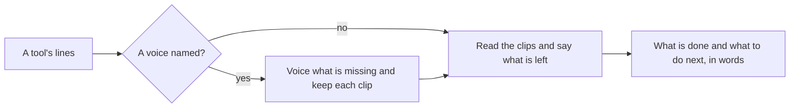
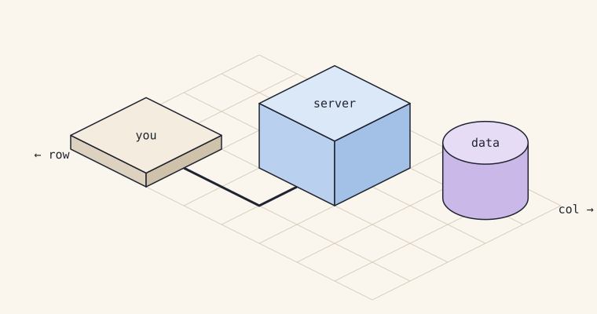

# footprint-story

For developers building narration and animation tools, or integrating the shared rules used by StoryDeck and StoryReel.

[Install and import paths](#install-and-import-paths) · [Text mapping](#one-text-as-shown-and-as-spoken) · [Captions](#captions) · [Motion](#how-things-move-motion) · [Shots](#a-camera-in-3d-shots) · [Guarantees and limits](#what-is-guaranteed)

**What a film and a deck share.** [StoryDeck](https://github.com/footprintjs/storydeck) (slide decks that narrate
themselves) and [footprint-storyreel](https://github.com/footprintjs/storyreel) (drawn films) tell stories the same
way: a voice says the words, captions show them, and things move on screen. Each used to keep its own copy of those
rules, and the copies had started to disagree. This package holds them once. It was called `footprint-narration`
until 0.3.0, when the motion words joined it.

**What a voice says, and what a caption shows.** A voice drops or garbles digits and a forced aligner knows only
letters, so a narration is *said* in words while its captions *show* it as written: "16.67 ms" is said "sixteen
point six seven milliseconds", "UI" is said "U I", and a lone "—" is not said at all. The main door owns that one
law and everything that rests on it: the shown↔spoken map, sentences and word times, caption cues and caption
files, YouTube chapters, and — for Node — a voice port with a clip cache keyed by exactly what is said.

**How things move.** A curve, a spring, a move such as "slam", a change of picture such as "push" and how long a
picture may sit still are words both tools use, so they are named here once. Nothing here draws: StoryReel paints
them on a canvas, StoryDeck plays them in a page.

## Install and import paths

```sh
npm install footprint-story
```

Twelve doors, nothing else. A door loads only when you import it, so a page that only captions never loads motion:

| door | what | runs |
|---|---|---|
| `footprint-story` | the shown↔spoken map, sentences, captions, chapters | anywhere — browser or Node; no dependencies |
| `footprint-story/voice` | the voice port, the clip cache, its two adapters: the Chatterbox kit and your own recorded takes | **Node only** (files, child processes) |
| `footprint-story/motion` | eases and springs, moves, transitions as data, pace, turns (an order written once) | anywhere — browser or Node; no dependencies |
| `footprint-story/storyboard` | a story written as data on a named shape, read and checked for both tools to draw | anywhere — browser or Node; no dependencies |
| `footprint-story/shot` | a camera in 3D as data, its projection maths, and a check of what it sees, in text; camera moves between shots (slerp, arc or cut, timed by minimum jerk, checked by critics) | anywhere — browser or Node; no dependencies |
| `footprint-story/isometric` | a floor of tiles seen from a corner: where a point lands, a box's faces, the order to draw in — and where things stand, worked out from what is joined to what | anywhere — browser or Node; no dependencies |
| `footprint-story/layout` | a flat frame as numbers: the zoom that frames a box, words broken across a width as they are drawn | anywhere — browser or Node; no dependencies |
| `footprint-story/record` | why a value of a run is so, read from the run's record file alone | **Node only**; needs `footprintjs` and `foottrace`, which a tool that runs a chart already has |
| `footprint-story/mapflow` | an isometric map built as a footprintjs chart, one stage per step, so a run's record says why each block stands where it does | wherever `footprintjs` runs; needs `footprintjs`, the caller's |
| `footprint-story/human` | how people move and draw: minimum jerk, Fitts's law, the two-thirds power law, sigma-lognormal strokes, a seeded tremor; the paths they run on; light physics (a throw, a fall, a bounce, a hanging chain, a spring settle); named models that plan a move from an intent, wrappers that reshape it, critics that say what still looks wrong, and hand-drawn strokes (a drawing's order, each stroke's pace and width, hatching, a boil) | anywhere — browser or Node; no dependencies |
| `footprint-story/geometry` | angles between points and the twist about a line, angles that wrap round, quaternions, slerp and squad (Shoemake), spherical places and great circles, a camera's look and its lean | anywhere — browser or Node; no dependencies |
| `footprint-story/humanflow` | the intent decider built as a footprintjs chart, one stage per step, so a run's record says why each move got its model and its duration | wherever `footprintjs` runs; needs `footprintjs`, the caller's |
| `footprint-story` (also) | `oneLine`, `errorText`: a row of a tool's reply stays one line whatever a project's files hold | anywhere |
| `footprint-story` (also) | `differsProblem`, `differsLines`, `timeWords` …: the rules for a part that differs from the real thing | anywhere |

What may join: only what both tools use, and only the shared words and maths — each tool keeps its own drawing. A
new topic gets its own door; a door becomes a package of its own only if it ever needs a dependency of its own (the record, mapflow and humanflow doors need none:
`footprintjs` and `foottrace` are the caller's, optional peers that both tools already have) or a release
pace of its own.

## A story written as data

An agent telling a story should not have to write a deck's HTML or a film's recipe. It fills in a **shape**, and every
mistake is named at once, so it fixes them in one pass. Whoever draws the board treats its words as text, never as code.

```js
import { storyShapes, storyboardBrief, storyboardProblems, storyboardFixBriefs, readStoryboard } from 'footprint-story/storyboard';

storyShapes();                   // [{ name, about, fills }]: the shapes, and a worked outline of each
storyboardBrief('what-we-found', { conversation });   // { instructions, material }: what a model needs to write one
storyboardProblems(fromAgent);   // [{ at: 'items[1].turn.callout', message: 'must say both names, …' }]
storyboardFixBriefs(fromAgent, problems, { conversation });   // { instructions, briefs, rest }: one short brief per piece at fault
const board = readStoryboard(fromAgent, { conversation: [{ id: 'm7', text: 'it waited 41 minutes' }] });
board.scenes[1];                 // { id, part, look, title, narration, beat }
```

A conversation becomes a story in three steps, and only the first needs a model: `storyboardBrief` gives the instructions
and the conversation for whichever model you use, `storyboardProblems` names what to fix in its answer, and a tool draws
the board. Send `instructions` as your own and `material` as data, because it holds a conversation's own words.
When a board is refused, `storyboardFixBriefs` gives a short brief for each piece at fault. It takes no answer itself, so say what
form you accept: a host that keeps its board can change just those pieces.

| shape | what it tells |
|---|---|
| `told-twice` | a cast of people and everyday things acts a system out, each turns into the real thing where it stood, then the same story runs again for real |
| `what-we-found` | what was checked, what was found, what is still not known (which must be written, even empty), and what happens next |

Given a conversation, a `what-we-found` claim must name the messages it rests on, and every number in it must be in one of
them; anything that cites none, such as its title, must use numbers from somewhere in the conversation. That catches a
wrong number. It does not catch a claim that is wrong in words, a number spelled out, or a sign (`-41` reads as 41). `verified` is true only when claims
really were checked: `told-twice` makes none, and with no conversation nothing is checked.

### A chatbot session as the conversation

A chatbot session file holds far more than what was said: tool calls and their output, the assistant's private thinking, the
host's own notes. `sessionReader()` keeps what the person said and what the assistant answered, one turn per message with a
short id (`m1`, `m2`, …), and counts what it left out, by kind. It reads no file: hand it lines as you read them, so a session
bigger than memory is read a line at a time. A Claude Code session is one JSON record per line, and reads as it is.

```js
import { createReadStream } from 'node:fs';
import { createInterface } from 'node:readline';
import { sessionReader, storyboardBrief } from 'footprint-story/storyboard';

const reader = sessionReader();
for await (const line of createInterface({ input: createReadStream(sessionFile) })) reader.add(line);
const { messages, left } = reader.result();   // [{ id: 'm1', who: 'person', text }], { 'tool-result': 812, … }
storyboardBrief('what-we-found', { conversation: messages });
```

A session is untrusted: its words are a message's text, never instructions. A line that is not JSON, longer than about 2 MB,
or of a kind the reader does not know is counted and skipped, so one odd line costs nothing else. It keeps at most 5000
messages (what the storyboard door reads), 64 K characters of each and 64 M in all, and counts what it cut.

## A narration: one step for a film and a deck

Each tool says what its lines are, and this owns the rest. With no voice, `narrate` only reads, so asking costs nothing.



```js
import { narrate, narrationSummary, narrationVoice } from 'footprint-story/voice';

const cache = 'voice/cache';
const { engine, profile } = narrationVoice({ cache, kit: '../voice-kit' });   // or { cache, kit, takes } for your own recordings, or { cache } to only read
const report = await narrate(lines, { cache, profile, engine });
console.log(narrationSummary(report));   // 12 of 15 lines voiced · 3 to voice · 2 silent · 48.2 s so far …
```

A voice kit runs Python on your machine, so take its folder only from your own command or a server's start, never from a
project's files. StoryDeck and StoryReel each have a `narrate` command built on this.

## One text, as shown and as spoken

A **slot** says one exact place by hand; the **rules** say everything else. Use either or both.

```js
import { spokenMap, autoRules } from 'footprint-story';

spokenMap('Keep latency < 10 ms — the UI waits.', { rules: autoRules() }).spoken;
// 'Keep latency less than ten ms, the U I waits.'

const map = spokenMap('One frame takes 16.67 ms, at 60 Hz.', {
  slots: [['16.67 ms', 'sixteen point six seven milliseconds'], ['60 Hz', 'sixty hertz']],
});
map.spoken;   // 'One frame takes sixteen point six seven milliseconds, at sixty hertz.'
map.pieces;   // [{ shown: 'One frame takes ', spoken: 'One frame takes ', kind: 'text' },
              //  { shown: '16.67 ms', spoken: 'sixteen point six seven milliseconds', kind: 'slot' }, …]
```

The automatic rules spell the few acronyms a voice misreads as a word (`SPELL`: UI, API, APIs — every other
acronym stays, since a cloned voice says LLM or MCP as quick letters), say a lone symbol that means something
(`SAY`: `& + = × %`, Greek letters, and `< >` before a number only — "File > Save As" is a menu path), say numbers
in words, and turn every other word without a letter (— → … | an emoji) into a pause: its sentence end moves onto
the word before, else that word gets a comma. Bring your own lists — `autoRules({ spell: { ...SPELL, 日本: 'Japan' } })`
— or your own strategy (`{ name, apply(pieces) }`).

**Back to what is shown.** A voice aligner times the words it *said*. `shownWords` collapses each said run back
into what the text shows, timed from its first word to its last, so captions show digits where the voice said words:

```js
import { shownWords } from 'footprint-story';

shownWords(map, alignedWords).map((w) => w.text);   // ['One', 'frame', 'takes', '16.67 ms,', 'at', '60 Hz.']
```

`spokenOffset` maps a phrase written as shown onto the spoken words (so "at 60 Hz" finds "at sixty hertz"),
`unsaidDigits` lists the digits a voice would still have to read, and `checkSlots` refuses a slot list that cannot
be right, naming the fix.

## Captions

Two producers — by sentence (a deck's clips know each sentence's start) and by word (a film's aligner knows every
word) — one cue shape, **one writer**, one reader.

```js
import { captionCues, captionChunks, captionFile, readCaptions, FILE_CHUNKS } from 'footprint-story';

const cues = captionCues([{ start: 10, lead: 0.5, written: 'In 2000. Done.', spoken: 'In two thousand. Done.',
  clip: { duration: 4, sentences: [0.2, 2.5] } }]);                     // shows "In 2000." while the voice says it
const chunks = captionChunks([{ offset: 3.3, duration: 4.1, words }], { maxWords: 5 });   // burned-in chunks
captionFile(captionChunks(tracks, FILE_CHUNKS), 'srt', { offset: 2 });   // a numbered SRT, two lines at most
readCaptions(vttOrSrt);                                                  // back to [{ start, end, text }]
```

The writer numbers the cues, moves them onto the video's clock (`offset`), cuts them to a partial render
(`from`, `to`), wraps a long text onto two lines near its middle, never lets `-->` into a text, and escapes
WebVTT's `& < >`; the reader reads both formats and those escapes back.

## YouTube chapters

YouTube shows chapters only when the first is at 0:00, there are at least three, and each lasts 10 s or more.
`youtubeChapters` fixes what it can and says what it did.

```js
import { youtubeChapters } from 'footprint-story';

const list = youtubeChapters([{ at: 3, title: 'Card' }, { at: 6, title: 'Intro' }, { at: 40, title: 'One' },
  { at: 45, title: 'Aside' }, { at: 80, title: 'Two' }], { length: 205 });
list.text;      // '0:00 Intro\n0:40 One\n1:20 Two'
list.changes;   // Card replaced by Intro · Intro moved to 0:00 · Aside merged into One
```

## A voice, cached by what it says (Node)

```js
import { chatterboxKit, voiceClips, clipFor } from 'footprint-story/voice';

const engine = chatterboxKit({ kit: '../voice-kit' });                 // a local voice kit; nothing is uploaded
await voiceClips(texts, { cache: 'voice-cache', profile, engine });    // voices only what has no clip yet
clipFor(texts[3], { cache: 'voice-cache', profile });                 // { key, audio, duration, sentences, words }
```

A clip's key is a hash of its recipe — the voice profile's settings and the exact spoken text — so editing one
line re-voices that line alone, and an interrupted run keeps every batch it finished. The engine is a port,
`{ name, synthesize(scenes, { work }) }`; `chatterboxKit` is one adapter, a test fake or a cloud voice is another.
Clone only your own voice.

## Your own voice, recorded (Node)

**Why:** a cloned voice is a stand-in. When you would rather read the script yourself, each recording should land
in the film or deck exactly as a cloned line does: the same lead and tail of silence, its words timed against the
known text by the same aligner, cached by the same key recipe. `recordedTakes` is the second adapter of the voice
port, so nothing downstream changes.

```js
import { recordedTakes, voiceClips, clipFor } from 'footprint-story/voice';

const takes = recordedTakes({ kit: '../voice-kit', takes: 'takes' });          // your recordings + the kit's aligner
await voiceClips(texts, { cache: 'voice-cache', profile: takes.profile, engine: takes, batch: 50 });
clipFor(texts[3], { cache: 'voice-cache', profile: takes.profile }).take;
// { file: '004.m4a', trim: { length: 6.1, clip: 4.35, kept: 4.35, cutBefore: 0.82, cutAfter: 0.31, padBefore: 0, padAfter: 0,
//   pauses: [{ at: 2.4, was: 1.62, now: 0.6 }] }, check: { words: 14, meanScore: 0.86, lowWords: [['latency', 0.21]], letterMatch: 0.97 } }
```

The folder holds one recording per line (WAV or M4A, any name) and a `takes.json` that maps each line, as it is
said, to its file: `{ "One frame takes sixteen point six seven milliseconds.": "004.m4a" }`, every file inside the
folder. A line finds its take word by word, so case and punctuation do not matter, while "a part" is not "apart". A line with no take is refused, with every such line listed
and ready to paste into `takes.json`. The file names stay your recorder's, and an edited line is listed again
instead of being cut from a take of the old words. Each take then goes through four steps:

- **find**: its take in `takes.json`.
- **trim**: with ffmpeg, give every clip exactly the kit's 0.2 s before the first sound and 0.4 s after the last
  (a longer silence is cut, a shorter one padded), and shorten every pause longer than 0.6 s to 0.6 s. A short word
  at either end is kept; a click farther than 0.6 s from the speech is cut. The cut is computed in whole samples, so
  the same take always gives the same bytes.
- **align**: the kit's own MMS_FA aligner runs offline in the kit's Python, through `align_take.py`, which ships
  here. It never downloads: without the aligner's weights on disk, it refuses (run the kit's setup once).
- **check**: as the kit's `check_words.py` does it. A take the aligner cannot fit to its words is refused; a
  low-scored word is reported, for you to listen to.

What each step decided is the clip's `take` record, kept beside it in the cache.

The session's `profile` is a hash of the takes' bytes and the trim settings, so a recorded line and a cloned line of
the same text never share a key, and a line recorded again is never served stale. `voiceClips` refuses a recorded
engine with any other profile, and a recorded profile with any other engine. It also refuses a `work` folder that is
the takes folder, holds it or lies inside it, because a work folder is emptied before each batch.

- **Use a large `batch`.** Each batch loads the aligner's model once, about 2 s here, so `batch: 50` saves a load
  every few lines. The default stays 4 because batching is the cache's rule for every engine, and an interrupted run
  keeps each finished batch either way.
- **Reading clips without the takes.** `takes.profile` is two strings. Save it with the deck, and a machine without
  the recordings reads every clip with `clipFor(text, { cache, profile })`. `voiceClips` with no engine counts what
  is cached, and throws, as it always did, when a line is still to voice.
- **The limit:** the session cannot be pinned by name. Any change to the takes (a line recorded again, a new line, a
  trim setting) gives a new session, and every line is cut and aligned again. That takes seconds per line and
  generates no voice. A pinned id would let a line recorded again keep its old clip, because the cache never asks an
  engine about a clip it already has.

The voice is yours alone: never use this for anyone else's.

## How things move (motion)

**Why:** a move should look the same in a film and on a slide, and nobody should keep a second copy of a spring.
Every value is a pure function of time, so frame 812 is drawn without drawing 0–811.

```js
import { easeNamed, moveAt, movesBy, readTransition, readPace } from 'footprint-story/motion';

easeNamed('cubic-bezier(0.16, 1, 0.3, 1)')(0.5);   // the curve a browser draws for that text
moveAt('slam', 0.1);                  // { opacity, x, y, scale: 1.106…, rotate, blur: 0.18…, clip, progress, mask }
movesBy({ feel: 'heavy', use: 'text' });            // [slam]
readTransition({ type: 'push', from: 'left' }, 'click 3');
// { type: 'push', family: 'motion', seconds: 0.7, ease: 'inOut', sound: 'slide', p: { from: 'left' } }
readTransition('iris', 'click 4', { frame: [1920, 1080] }).p.at;   // [960, 540]: the middle of this frame
readPace('promo');   // { hold: 0.6, most: 0, still: 0.4, spare: 1 }: nothing still past 0.6 s, the end card spared
```

Moves keep their kind's law (an entrance ends at rest, an exit starts there, an ambient move loops from rest), and a
move of your own is checked by the same laws. A drawer adds its own transitions with `extendTransitions`, checked the
same way. More in [src/motion/README.md](src/motion/README.md).

### A hand that moves like one (human)

**Why:** a reach, a pen line or a letter looks human only when it follows how bodies move. The author writes the
intent; a named model plans it from a law — the duration from Fitts's law, never a guess — and says why in words;
critics measure the result and name what still looks wrong, with the fix. The same entry draws the same motion.

```js
import { planMove, sampleMove, checkMove } from 'footprint-story/human';

const move = planMove({ do: 'reach', name: 'hand', who: 'blocks[2] ("hand")', from: [200, 600], to: [500, 200] });
move.reason;            // "do: 'reach' → min-jerk, the usual for do: 'reach' — over 0.85 s from Fitts's law: 500 px to a 40 px target …"
sampleMove(move, 0.4);  // { x, y, progress }: frozen, the same every time
checkMove(planMove({ do: 'draw', path: [[100, 100], [300, 180], [420, 90]] })).findings;   // []: slower in the bends, as a hand
```

`do: 'reach'` (minimum jerk), `'draw'` (a centripetal Catmull-Rom line traced by the two-thirds power law, with a
seeded tremor), `'write'` (overlapping sigma-lognormal strokes), `'throw'` and `'fall'` (a ballistic flight, or a bounce
to rest), `'hang'` (a Verlet chain that swings until it settles), `'settle'` (the motion spring), `'roll'` (rolling
without slipping, its turn distance / radius, to rest or a box), `'slide'` (kinetic friction to rest) and `'tumble'` (a
spinning flight, handed over at the landing to a roll or a slide); `anticipate`,
`followThrough`, `hold` and `overshoot` reshape any move, keeping its ends:

```js
import { planMove, sampleMove, overshoot } from 'footprint-story/human';

const ball = planMove({ do: 'throw', from: [100, 600], to: [700, 600] });   // a 45° throw over 0.78 s, from the physics
sampleMove(overshoot(ball, { by: 12 }), 0.9);   // landing 12 px past and settling back on a spring
```

**A list of intents, every move decided.** `planIntents(intents)` runs the intent decider: read → choose (the model by
rules as data, `CHOOSE_RULES`: the one the intent names, else its family's usual) → plan → wrap (an intent's `wrap:
[{wrapper: 'anticipate', …}]`) → sample (a bounded summary) → check → findings, each a pure step of `HUMAN_STEPS`. It
gives, per intent, the choice and its rule, the plan and its basis, the move, its track summary, the critics' measures,
and one list of findings naming `who` and the fix. `footprint-story/humanflow` runs the same steps as a footprintjs
chart, so a run's record answers why a hand takes 0.85 s — one entry asked by its own key, `duration-0` (`runHumanFlow`, then `whyFromRecord`):
[src/humanflow/README.md](src/humanflow/README.md).

```js
import { planIntents } from 'footprint-story/human';

const r = planIntents([{ do: 'reach', name: 'hand', from: [200, 600], to: [500, 200] }, { do: 'throw', from: [100, 600], to: [700, 600] }]);
r.choices[1].model;    // 'ballistic' — "the intent names none: its family's usual"
r.durations[0].basis;  // { distance: 500, target: 40, targetDefaulted: true, bits: 3.75…, … }: Fitts's numbers
r.findings;            // []: nothing looks wrong
```

**A drawing, drawn by hand.** `planMove({do: 'sketch', shapes})` plans every stroke of a drawing as a hand draws it:
piece by piece from the top left, outline, then detail, then fills, in the fewest strokes the corners allow; each stroke
slower in the bends, thinner when fast, tapered, hooked at a sharp corner, with the capped tremor; hatching,
cross-hatching and scribbles clipped exactly to their shapes; `boilSketch(plan, frame)` redraws it each held frame. The
critics `pen-lifts`, `stroke-order` and `hatch-gaps` say when an order is not a hand's, and `pace` when it is drawn
faster than a hand draws (a `seconds` too short for it, with the seconds it needs):
[src/human/strokes/README.md](src/human/strokes/README.md).

```js
import { planMove } from 'footprint-story/human';

const box = planMove({ do: 'sketch', name: 'box', shapes: [{ points: [[100, 100], [300, 100], [300, 300], [100, 300]], closed: true, fill: { kind: 'hatch' } }] });
box.plan.order[0];   // { stroke: 0, layer: 'outline', group: '', rule: 'first', at: [100, 100] }: the top-left corner first
```

A tool adds its own model or critic under its prefix (`'reel:chalk'`). Physics: [src/human/physics/README.md](src/human/physics/README.md). More in [src/human/README.md](src/human/README.md); the papers in
[src/human/REFERENCES.md](src/human/REFERENCES.md).

### An order written once (turns)

**Why:** "the view moves, then three things come one after another, then two together" is said the same way for a
click of a deck and a beat of a film. `stagger` covers one gap between items; this covers the rest.

```js
import { readTurns, turnTimes, writeTurns } from 'footprint-story/motion';

const turns = readTurns('camera laptop (dns server) w1:1.2 db');
// names in the order they come · (a b): together · name:seconds: that turn's own time
turnTimes(turns, { step: 0.35 });
// { turns: [{ names: ['camera'], at: 0, takes: 0.35 }, … { names: ['db'], at: 2.25, takes: 0.35 }], last: 2.25, end: 2.6 }
writeTurns(turns);   // 'camera laptop (dns server) w1:1.2 db'
```

Seconds are kept to the millisecond, so what is written always reads back. The bounds (256 turns, 64 names in a turn,
8192 characters) hold while it reads: a huge order is refused at its 257th turn.

Names alone read as a plain list, each its own turn. The names mean nothing here: a tool looks them up in its own
picture, and passes `isName` when one of its names looks like the written form.

### A packet riding a line (ride)

A deck's running packets and a film's ride the same line the same way: `rideProfile([0.15, 0.2], 900)` is where a
packet is over its ride, eased out of its start and into its end over shares of the line's LENGTH, as stops for CSS's
`linear()` or a film's own interpolation (within 0.4 px of the true ease). `rideSeconds(length, speed, ease)` is the
ride's time for a steady speed in px a second, `withHold` adds a rest at the end, `showStops` says how much of the
packet shows, and `hiddenRamps` where it fades before a stretch a block hides and back after it. Numbers in, numbers out.

## A camera in 3D (shots)

**Why:** a film and a deck should say a shot in the same words, and whoever writes one should learn what the camera really
sees without reading a picture. A scene is plain data, a shot names where the camera stands, and the check answers in one line.

```js
import { readShot, frameOf, checkShot, shotLine } from 'footprint-story/shot';

const scene = {
  unit: 'm',
  things: [
    { name: 'database', at: [0, 0, 0], r: 1 },          // a ball; a point has no r, and a card has a size: [w, h]
    { name: 'cache', at: [-2, 1.2, 2.2], r: 0.5 },
    { name: 'proxy', at: [3, 0, -6], r: 1 },
  ],
};
const shot = readShot({ on: 'database', from: 'front-left high', size: 'medium' }, scene);
const camera = frameOf(shot, scene);    // { target, azimuth, elevation, distance, focal, aperture }
shotLine(checkShot(scene, camera, [1280, 720], shot));
// shot "database" from front-left high (6.33 m, lens normal): in frame 100%, 40% of height (medium), "cache" covers 43% of it, sharp — move the view or lift it
```

`from` is a named view: `front`, `front-left`, `left`, `back-left`, `back`, `back-right`, `right` or `front-right`, then `high`,
`level` or `low`. `size` is `wide`, `medium`, `close` or `insert`, and `lens` is `wide`, `normal` or `long`. A camera may also come
from a film's own numbers: `checkShot(scene, camera, frame, { on })` reads any camera, and the line says `about` when it stands
near a named view rather than on it. The check reports a subject behind the camera, off frame, cut off, too small, covered by
something nearer, edge-on, showing its back or out of focus, and a camera on top of its subject.

Where things land, each thing's box and whether it is cut off are exact. Shares are areas on the frame, cut from the outlines
things really fill, so a thin card counts as surely as a wide one. On 600 random scenes, a third with thin cards as the subject,
against a separate dense oracle: worst error 0.2 points for in frame and 0.4 for covered, and 1.9 where a ball passes through
something, the one case that is sampled. There a clear result says so: `"rod" passes through it`. An overlap under about a third
of a pixel is not counted.

**The check knows only the scene it is given,** and the line says how many other things it was tested against: `none of the 3
other things in front`, or `no other things given`. A flat layer over the picture, a caption or a bond is not there unless you
add it as a thing, and every thing with a size is solid. Two things in one shot's `on` can hide each other, and that is reported:
name a tight cluster as one ball. The sizes, the lenses and "too small" are starting choices, not measurements. Nothing here draws, and no tool reads a shot yet. More in [src/shot/README.md](src/shot/README.md).

**Moving between shots.** `planCameraMove({do: 'fly', from: shotA, to: shotB}, scene)` or `{do: 'orbit', around, by}` picks
how the camera goes from a rule table and says why: a turn of at most 45° keeps its height and turns at one speed (a slerp), a
larger one rises 10° over its middle (an arc), and a fly past 150°, or one that would take longer than 12 s at a comfortable
pace, cuts. The seconds come from the minimum-jerk law and three limits (a turn of 45°/s, a slide of 1 frame height a second,
a growth of 2× a second; ours) unless given. `cameraTrack(move)` samples it, each sample a camera with its eye and its look as a
quaternion, both ends exactly the cameras handed in. `checkCameraMove(move, {scene, frame})` says what still looks wrong:
the subject hidden on the way (`in-sight`), a turn too fast (`turn-speed`), a slide or a zoom too fast (`travel-speed`), a crossing of the line between two subjects
(`line-of-action`), a horizon that leans (`horizon`) — each finding names `who` and the fix in the intent's keys
(`lift: 25`, `seconds: 4.42`). The geometry it stands on has its own door, `footprint-story/geometry`: [src/geom/README.md](src/geom/README.md).

## A floor seen from a corner (isometric)

**Why:** a system drawn as blocks on a floor reads at a glance, and a film and a deck should place those blocks the same
way. The grid gives numbers; each tool draws with them.



```js
import { isometric } from 'footprint-story/isometric';

const grid = isometric({ tile: 120, origin: [960, 240] });
const server = { at: [2, 1], size: [2, 2, 1.5] };            // col 2, row 1: 2 wide, 2 deep, 1.5 high
grid.block(server);                    // { top, left, right, outline, centre, box }: three faces, four points each
grid.cylinder({ at: [6, 0], size: [2, 2, 1] });              // { top, bottom, centre, box }: two ellipses
grid.floor({ cols: 8, rows: 5 });      // { outline, lines, box }
grid.route([2, 4], [4, 3]);            // a line along the floor, turning once
grid.backToFront(things);              // the furthest first: only things that meet on the frame are ordered
```

The picture above is drawn from these numbers by a test, so it is what the grid gives today. A cube looks like a cube:
the grid is checked against a camera with no depth, built in the test from first principles, and the drawing order
against lines of sight worked out apart from the code.

**No places to type.** Say what is joined to what, and `arrange` says where each thing stands, far enough apart that
the floor shows between them; `gridFor` then gives the grid on which they fill a box of the frame. The same things and
links always give the same places.

```js
import { arrange, gridFor } from 'footprint-story/isometric';

const { things } = arrange(
  [{ name: 'you', size: [2, 2, 1] }, { name: 'dns', size: [2, 2, 1] }, { name: 'server', size: [2, 2, 1] }, { name: 'db', size: [2, 2, 1] }],
  [['you', 'dns'], ['you', 'server'], ['server', 'db']],
);                                     // you at [0, 2]: before the two it asks, in their middle · dns [5, 0] · server [5, 4] · db [10, 4]
const grid = gridFor(things, [0, 220, 1920, 1000]);          // a tile as wide as lets them all sit in that box, the picture in its middle
things.map((thing) => grid.block(thing));                    // each is a thing the grid draws
```

Along the cols a long chain is a long slant down the frame. `arrange(things, links, { across: true })` runs the steps
across the frame instead, left to right, which fills a frame wider than it is tall.

**Links along the floor.** `routes(things, links)` gives each link a way along the tile lines, round what stands in
its way, from a foot a viewer sees to a foot a viewer sees; a request and its answer lie in two lanes. Each result
says what happened (`behind: ['logs']`, or `why` it has no way), and `routeNote` says it in words, so a person or a
model can change the picture without looking at it. `rounded(points, radius)` rounds the corners and gives the point
a share along the way: a deck's packet and a film's frame stand at the same place.

**What a deck and a film both ask of a picture.** `hairpins(route.path, route.ports)` says, in a word, where a way
doubles back on itself (`'start'`: the port faces away). `floorUnder(box, grid)` is the floor under words that float
over the picture, as `routes`' `keep` takes it, and `crossesBox(points, box)` whether a way on the frame runs through
them. `floorLabelPlace(floor, grid, name, covers)` lays a floor's name flat along its front edge, clear of what stands
there. `arrangeByGroup(things, links)` places each group's things together, then the groups, from what joins them.

A cable between two blocks is laid by `routes` and rounded by `rounded`; where its label stands on it, and a wire
drawn straight where there is no way along the floor, are worked out here too, so a slide and a film put them in the
same place:

```js
import { CABLE, labelHalf, labelPlace, held, lanesOf, straightRun, bentWire, curveWay, arrowHead, cableWay } from 'footprint-story/isometric';

const api = { middle: [300, 200], outline: [[240, 150], [360, 150], [360, 250], [240, 250]] };   // what a block draws
const db = { middle: [700, 260], box: { x: 640, y: 200, w: 120, h: 120 } };                     // a flat piece's box
const [lane] = lanesOf([['api', 'db']]);                    // { k: 0, count: 1, flip: false }
const run = straightRun(api, db, lane);                     // { start, end }: 6 px off each edge
const bend = bentWire(run.start, run.end, 24, CABLE.head * CABLE.headShort);   // the curve's corner, its tip, the way it arrives
const line = curveWay(run.start, bend.corner, bend.tip);    // a way, as rounded() gives one: a packet rides it by length
const head = arrowHead(run.end, bend.heading);              // [tip, left, right]
const plate = labelHalf('SQL'.length);                      // [22, 13]: half the label's plate
const at = labelPlace(line, plate, [held(api.outline)], [], { left: CABLE.looks }, run.end);   // its middle, clear of the block
```

A laid cable's line, its tip pulled back for its head (never past 1 px short of its last run's start) and its corners
rounded, is `cableWay({points, radius}, back)` (the points alone, before rounding: `stopShort(points, back)`) — so a deck's line
and a film's stop at the same place:

```js
const cable = cableWay({ points: [[0, 0], [200, 0], [200, 20]], radius: 30 }, CABLE.head * CABLE.headShort);
cable.at(1);                                                // [200, 5.6]: where the head begins
```

A lead into a port on a seen side is drawn again over its block (the cable lies under every block); `cableLead(cable,
end, count, back)` gives it from that end through its floor corner — `{way, pieces, length}` — and `length` over the
line's length is the share where a packet passes onto it.

Each refuses what it cannot read, by name; `straightRun` gives `{why: 'middle' | 'close'}` where the two pieces share a
middle or stand too close, and the tool words it.

**Styles.** A map's look is a row of named choices, one per column — `shape`, `shading`, `line`, `palette`, `texture`,
`effects` — and each choice gives back a **paint list**: plain items (polygons, ellipses, paths, lines) with a role, a
fill and a stroke, which each tool paints (StoryReel on a canvas, StoryDeck as SVG). Today's look is the usual style;
`line: {name: 'ink', width: 5}` widens every line, `line: 'none'` drops the outline. Two **named looks** (0.34.0,
`ISO_LOOKS`) are rows under a name, written in a row as `{look: 'outlined'}` (a bold, even contour round each piece and
lighter inner lines) or `{look: 'line-art'}` (paper-white faces, ink lines only: silhouette 3 px, folds 1.25 px, the
tile lines faintest); a column written beside a look replaces its entry. Two more (0.35.0): `{look: 'paper-grain'}`
(a fine, faint, seeded grain over every face, footprint-story/human's `grainTexture` handed in) and `{look: 'duotone'}`
(two inks: every line the ink, every fill with a colour a tint of the accent, a name in the ink at 4.5 : 1 or more on
every tint; a fill the page colours — a tool's ok / warn / bad — is left to the page). And (0.37.0) `{look: 'sketchy'}`:
drawn by hand on paper — edges sketched as a hand draws them, sides hatched, the shadow side cross-hatched (the human
door's choices handed in: `{choices: HUMAN_STYLE_CHOICES}`). A piece may be a `ball` (StoryReel's round kind): every
style and look paints it, its silhouette lit as a top, two seams on it. A tool adds its own choice under its own
prefix (`'reel:chalk'`); the style is plain data, so a run's record says which choices (and which look) drew a map.

```js
import { isometric, isoStyle, paintPiece } from 'footprint-story/isometric';

const style = isoStyle({ line: { name: 'ink', width: 5 } });          // { row: {shape: 'box', …, line: 'ink', …}, options: {line: {width: 5}} }
paintPiece(style, { name: 'server', kind: 'block', at: [2, 1], size: [2, 2, 1] }, isometric({ tile: 120 }), { base: '#d9e4f3', ink: '#14181f' });
// → { box, items: [{ item: 'polygon', role: 'left', of: 'server', points, fill: { mix: ['#000000', 0.06], colour: '#ccd6e4' }, stroke }, …] }
```

More in [src/isometric/README.md](src/isometric/README.md) and the design, [docs/design/2026-11-iso-styles.md](docs/design/2026-11-iso-styles.md).

**A whole map, as named steps.** `buildIsoMap(spec, policy)` builds a map from the map as data (blocks, floors, wires,
a grid or an area, a style) and a tool's numbers (`ISO_MAP_POLICIES.film` or `.deck`): place, route, fitFloors, grid,
shape, names, order, floorLabels, style (`ISO_MAP_STEPS`), each a pure step that reads and writes plain data. The two
that choose say why as data (`placed: 'build'`, `placedWhy: 'no block has an at: …'`). Moved from StoryReel 0.38.0 and
pinned against a copy of it; neither tool uses it yet. `footprint-story/mapflow` runs the same steps as a footprintjs
chart, so a run's record answers why a block stands where it does (`runMapFlow`, then `whyFromRecord`). A hand-drawn map
names `human:sketchy` / `human:hatch` in its style and hands the choices beside the spec and the policy:
`buildIsoMap(spec, policy, { choices: [sketchyLine, hatchTexture] })`, the same for `runMapFlow`'s options:
[src/mapflow/README.md](src/mapflow/README.md), and the design, [docs/design/2026-11-map-flow.md](docs/design/2026-11-map-flow.md).

```js
import { buildIsoMap, ISO_MAP_POLICIES } from 'footprint-story/isometric';
const map = buildIsoMap({ blocks: [{ name: 'web', size: [2, 2, 1] }, { name: 'db', kind: 'cylinder', size: [2, 2, 1] }],
  wires: [{ from: { block: 'web' }, to: { block: 'db' } }], area: [0, 0, 1600, 900] }, ISO_MAP_POLICIES.film);
map.at; map.view; map.shapes; map.order; map.paints   // where, the grid, each piece's faces, the paint order, the paint lists
```

## A part that differs from the real thing (differs)

A picture is believed: a process run 30 times faster, or a part drawn far larger than it is, reads as how the thing
is unless the part says otherwise. A deck part (`data-differs-*`) and a film scene (`differs`) declare how they differ —
`time` (how many times faster), `scale` (what is out of scale, in words), `analogy` (what stands in for what) — and say
it on the picture, in the voice, or both. The rules and the default words live here; each tool reads its own fields
and words its own refusal from the code the kit gives back.

```js
import { differsLines, differsProblem, timeProblem } from 'footprint-story';

timeProblem(1.004);                                   // 'real-time': it reads as 1 time, so leave it out
const d = { time: 30, scale: 'The dots are drawn far larger than real' };
differsLines(d);                                      // ['Time shown 30 times faster', 'The dots are drawn far larger than real']
differsProblem(d, ['Shown 3 times faster'], null);    // { problem: 'unstated', named: ['time', 'scale'], statements: 2, says: 1 }
differsProblem({ time: 30 }, ['Shown 3 times faster'], null);   // { problem: 'contradicts', figure: '3' }
```

The checks, in order: two phrases that are the same words, nothing said at all, a statement with no line or phrase
of its own, and a number in the time's line that is not the declared factor (`1,000` and `1.000` both read as a
thousand). `differsEnglish(d, lines, lang)` names a default English line a deck or film in another language still
shows. More in [src/differs/README.md](src/differs/README.md).

## A flat frame: framing a box, breaking words (layout)

```js
import { frameZoom, wrapWords, narrowestWidth, BREAK_RULES } from 'footprint-story/layout';

frameZoom([400, 200], [1600, 900], { share: 0.7, least: 1, most: 2.5 });   // 2.5: the box fills 70% of the room, held at 2.5×
const measure = (text) => ctx.measureText(text).width;
const lines = wrapWords(words, 600, measure);                               // first fit, each line measured whole
const even = wrapWords(words, 600, measure, { break: 'even' });            // as many lines, as alike as they allow
BREAK_RULES;                                                               // ['fill', 'even']: the rules, by name
```

`frameZoom` is the one framing rule: StoryDeck's zoom, fit and side movers and StoryReel's focus and pushes contain the
box in the room, take `share` of that and hold it between `least` and `most` (`smallest` counts a point as a pixel).
`wrapWords` and `narrowestWidth` are StoryReel's title, end-card, summary-card, whiteboard-title and caption breaking. A name on a block's face is `wordsToFit` (isometric), which now
takes a `measure` too. The break rule is a named choice on both: `wrapWords(…, { break: 'fill' | 'even' })` (fill the usual)
and `wordsToFit(…, { break: 'even' | 'fill' })` (even the usual), so a deck or film can let its writer pick and its
record can name the rule used. More in [src/layout/README.md](src/layout/README.md).

## API

| export | does |
|---|---|
| `spokenMap(text, { slots, rules })` | the text as shown and as spoken: `{ shown, spoken, pieces, norm }` |
| `autoRules({ spell, say })`, `SPELL`, `SAY` | the automatic strategy and its default lists |
| `checkSlots(text, slots, { name, field })`, `findSlot` | refuse a slot list that cannot be right; where a slot stands whole |
| `shownWords(map, words)` | timed spoken words, shown as written |
| `spokenOffset(map, at, { end })`, `unsaidDigits(map)` | a shown offset in the spoken text; the digits left to read |
| `numberWords(n)`, `normSpeech(text)` | a number in words; how two spellings are compared |
| `sentences`, `saidSentences`, `sentenceStarts` | split as a voice script splits; where each sentence starts |
| `captionCues(steps)`, `captionChunks(tracks, opts)`, `captionAt` | cues by sentence; chunks by word; the word being said |
| `captionFile(cues, kind, opts)`, `readCaptions`, `stamp`, `FILE_CHUNKS` | the one writer, its reader, its clock |
| `youtubeChapters(marks, { length, min })`, `readChapters`, `clockText` | chapters fixed and reported; read back; their clock |
| `/voice` `clipKey`, `clipFor`, `voiceClips`, `pickSteps`, `chatterboxKit`, `recordedTakes` | the clip cache and the voice port's two adapters |
| `/storyboard` `storyShapes`, `storyboardBrief`, `storyboardProblems`, `readStoryboard`, `storyboardFixBriefs`, `dataLine`, `numbersIn` | a story as data on a named shape: what to write, what to fix, the board read |
| `/storyboard` `sessionReader`, `readSession` | a chatbot session (one JSON record per line) read as a conversation to cite |
| `/motion` `EASES`, `easeNamed`, `bezier`, `overshoots` | the ease table, any CSS cubic-bezier, which curves overshoot |
| `/motion` `spring`, `FEELS`, `readFeel`, `settleTime`, `pop`, `track` | closed-form springs by feel |
| `/motion` `MOVES`, `moveAt`, `readMove`, `movesBy`, `stagger` | named moves: their values at t, your own checked, a filter, delays |
| `/motion` `TRANSITIONS`, `readTransition`, `checkTransition`, `extendTransitions`, `readSettings` | changes of picture as data, read and checked |
| `/motion` `PACES`, `readPace` | how long a picture may sit still, by kind of film |
| `/motion` `readTurns`, `turnTimes`, `writeTurns`, `MOST_TURNS`, `MOST_TOGETHER`, `MOST_TURN_NAME`, `MOST_TURNS_TEXT`, `MOST_TURN_SECONDS` | an order written once: read, timed, written back; its bounds |
| `/motion` `rideProfile`, `rideSeconds`, `speedAt`, `withHold`, `showStops`, `hiddenRamps`, `onStops`, `seenTerms`, `seenAt`, `MOST_EASE` | a packet riding a line: eased ends along its length, its time from a speed, a rest, how much shows, fades behind blocks; a value on stops at a moment, how much of a packet shows there |
| `/shot` `readView`, `readScene`, `sceneProblems`, `readShot`, `shotProblems` | named views, scenes and shots, read and refused in words |
| `/shot` `readCamera`, `frameOf`, `distanceFor`, `apertureFor` | a camera's numbers; the camera a shot asks for |
| `/shot` `project`, `unproject`, `boxOf` | a point on a frame and back; the box a thing fills |
| `/shot` `checkShot`, `shotLine` | what a camera sees of a subject, as a report and as one line of text |
| `/shot` `ROUNDS`, `HEIGHTS`, `SIZES`, `LENSES`, `MOST_THINGS` | the camera's words, and the most things a scene may hold |
| `/shot` `planCameraMove`, `sampleCameraMove`, `cameraTrack`, `checkCameraMove`, `CAMERA_MOVES`, `CAMERA_MOVE_RULES`, `CAMERA_MOVE_KINDS`, `CAMERA_MOVE_DOS`, `CAMERA_CRITICS`, `SIGHT_DROP`, `HORIZON_MOST`, `MOST_MOVE_SECONDS`, `MOST_ORBIT`, `MOST_LIFT`, `MOST_CAMERA_SAMPLES` | camera moves between shots: planned from an intent (its reason in words), sampled in time, checked by critics that say the fix: [src/shot/README.md](src/shot/README.md) |
| `/geometry` `angleAt`, `dihedral`, `wrapAngle`, `shortestTurn`, `unwrapAngles`, `quatFromAxisAngle`, `quatMultiply`, `quatNormalize`, `quatRotate`, `quatAngle`, `quatLook`, `quatForward`, `quatFromAxes`, `slerp`, `squad`, `toSpherical`, `fromSpherical`, `greatCircle`, `lookAt`, `horizonRoll` | the geometry leaf: angles between points, angles that wrap, quaternions, even turns (Shoemake), places on a sphere, a camera's look and its lean: [src/geom/README.md](src/geom/README.md) |
| `/isometric` `isometric`, `readThing`, `MOST_ISOMETRIC_THINGS`, `arrange`, `MOST_LINKS`, `gridFor`, `MOST_ALSO`, `routes`, `routeNote`, `NO_ROUTE`, `MOST_ROUTES`, `MOST_WORK`, `MOST_PORTS`, `readPorts`, `rounded`, `wordsToFit` | a floor seen from a corner: the grid (with `backToFront`, the order to draw in), a thing checked, the most things ordered; where things stand from what is joined to what, the most links read; the grid on which a picture fills a box |
| `/isometric` `hairpins`, `HAIRPINS`, `floorUnder`, `crossesBox`, `UNDER_CELL`, `MOST_UNDER_SQUARES`, `NO_UNDER`, `floorLabelPlace`, `MOST_FLOOR_LABEL`, `FLOOR_LABEL_ICON`, `MOST_COVER_POINTS`, `MOST_OUTLINE_POINTS`, `MOST_LABEL_LOOKS`, `arrangeByGroup`, `GROUP_MARGIN` | where a way doubles back; the floor under a box of the frame and whether a way runs through one; where a floor's name lies; placing by group |
| `/isometric` `isoStyle`, `paintPiece`, `ISO_LOOKS`, `CONTOUR`, `DUOTONE`, `ISO_STYLE_COLUMNS`, `ISO_STYLE_CHOICES`, `USUAL_STYLE`, `MOST_EFFECTS`, `MOST_OWN_CHOICES`, `PAINT_ITEMS`, `MOST_PAINT_ITEMS`, `MOST_PAINT_POINTS`, `mixColour` | a map's look as a row of named choices, and a piece's paint list in it |
| `/isometric` `readableInk`, `contrastRatio`, `luminance`, `deltaE76` | the ink a name reads in on a face (the first at 4.5 : 1, else the best, said so), and the colour measures behind it: [src/isometric/README.md](src/isometric/README.md#a-names-ink-the-ink-that-reads-on-a-face) |
| `/isometric` `buildIsoMap`, `ISO_MAP_STEPS`, `ISO_MAP_POLICIES`, `ISO_MAP_LIMITS` | a whole map built as named, pure steps from the map as data and a tool's numbers |
| `/isometric` `footOf`, `topOf`, `cornerOf`, `landingUnder`, `overTop`, `ridesOn`, `SAME_PLACE`, `footTiles`, `sideFoot`, `worldPx`, `LEVEL_SNAP`, `sweptThrough`, `checkMoments`, `deepestPass`, `passFinding`, `THROUGH_MOST`, `CHECKS_PER_SECOND`, `MOST_CHECKS`, `offFrame`, `drawnOff`, `posed`, `nameBox`, `overlapsBox`, `orderAt`, `hiddenNames`, `coverFinding`, `NAME_WIDTH` | moving pieces on a map: where a moving block stands and what it lands on, the rider rule, a foot from footprint-story/human's samples, the swept pass-through, a point off the frame, which names a block at rest hides |
| `/isometric` `CABLE`, `LABEL_PLACES`, `labelHalf`, `labelPlace`, `held`, `walkWay`, `cableWay`, `stopShort`, `cableLead`, `MOST_HIDES`, `exitOutline`, `exitBox`, `roundOutline`, `MOST_OUTLINE`, `lanesOf`, `straightRun`, `bentWire`, `curveWay`, `headingOf`, `arrowHead`, `MOST_WIRES` | a cable on the frame: its numbers, its label's plate and place on it, a way walked, its line stopped for its head, a lead into a port; a ray leaving an outline or a box, a cylinder's outline; a wire drawn straight: its lane, its ends, its bend, its curve, its head |
| `timeWords`, `analogyWords`, `differsFactors`, `foldDiffers`, `timeProblem`, `differsStatements`, `differsLines`, `differsProblem`, `differsEnglish`, `DIFFERS_MOST`, `DIFFERS_SAID_MOST`, `DIFFERS_TIME_MOST`, `DIFFERS_ANALOGY` | a part that differs from the real thing: its default words and the rules a declaration is held to, as data for the tool to word |
| `/layout` `frameZoom`, `wrapWords`, `narrowestWidth`, `NARROWEST_STEPS`, `BREAK_RULES` | the zoom that frames a box; words broken across a width as drawn, by a named rule (fill or even) |
| `/record` `whyFromRecord`, `controlEdges`, `WHY_LIMITS` | where a value of a run came from, read from the run's record file alone (Node only; needs footprintjs and foottrace, the caller's): [src/record/README.md](src/record/README.md) |
| `/human` `minJerk`, `minJerkSpeed`, `minJerkAccel`, `fittsIndex`, `fittsSeconds`, `FITTS`, `powerLawSpeed`, `powerLawTimes`, `powerLawFit`, `POWER_LAW`, `strokeBetween`, `sigmaLognormalAt`, `lognormalShare`, `lognormalSpeed`, `strokeOffset`, `strokeEnd`, `SIGMA_LOGNORMAL`, `tremorKnots`, `tremorAt`, `TREMOR` | the laws of a body's moves, each default named with its source |
| `/human` `arcTable`, `pointAt`, `shareToDistance`, `distanceToShare`, `catmullRom`, `curvatures`, `resample` | the paths they run on: length tables, a centripetal Catmull-Rom line, curvature, resampling by distance |
| `/human` `planMove`, `sampleMove`, `sampleTrack`, `checkMove`, `HUMAN_FAMILIES`, `HUMAN_DOS`, `HUMAN_MODELS`, `USUAL_MODELS`, `HUMAN_CRITICS` | an intent planned by a named model (its reason in words), sampled, and checked by critics that say the fix: [src/human/README.md](src/human/README.md) |
| `/human` `anticipate`, `followThrough`, `hold`, `overshoot`, `basePlan`, `isWrapped` | the animation principles as a move → a move, over any model, read by `sampleMove` |
| `/human` `launch`, `flightAt`, `fallSeconds`, `bounces`, `runChain`, `relaxChain`, `makeWorld`, `pushOut`, `collide`, `depthIn`, `verletStep`, `simulate`, `settleLeft`, `PHYSICS_STEP`, `GRAVITY` | light physics on a fixed step (Jakobsen 2001), for a tool's own model: [src/human/physics/README.md](src/human/physics/README.md) |
| `/human` `planSketch`, `sampleSketch`, `boilSketch`, `hatchLines`, `leastStrokes`, `withOvershoot`, `ORDER_RULE`, `SKETCH`, `CORNER`, `PEN_WIDTH`, `LIFT`, `BOIL`, `HATCH` | hand-drawn strokes: a drawing's order and why, each stroke's timed points and widths, fills clipped exactly, a bounded boil; `do: 'sketch'` plans one (model `hand-sketch`, critics `pen-lifts`, `stroke-order`, `hatch-gaps`, `pace`): [src/human/strokes/README.md](src/human/strokes/README.md) |
| `/human` `shapesOfPaint`, `strokeItems`, `strokeOutline`, `strokeAt`, `STROKE_CAPS`, `CAP_STEPS`, `sketchyLine`, `hatchTexture`, `grainTexture`, `GRAIN`, `MOST_GRAIN_MARKS`, `HUMAN_STYLE_CHOICES` | strokes and the isometric paint list (its `stroke` item): the ring a painter fills, its ends capped, and the stroke as drawn by a time; three style choices (a sketched line, a hatch, a paper's grain), handed to `isoStyle` or `buildIsoMap` in `choices` — `HUMAN_STYLE_CHOICES` is all of them |
| `/human` `planIntents`, `HUMAN_STEPS`, `HUMAN_INPUT`, `CHOOSE_RULES`, `MOST_INTENTS`, `SUMMARY_POINTS`, `PER_INTENT`, `intentKey` | the intent decider: a list of intents, every move decided by steps in one list — the model by rules as data, the plan and its basis, wrappers, a bounded track summary, the critics' findings; each intent's values also under keys of its own (`duration-3`) |
| `/mapflow` `mapFlow`, `runMapFlow` | the map's steps as a footprintjs chart, and a run of it with the reads kept (needs footprintjs, the caller's): [src/mapflow/README.md](src/mapflow/README.md) |
| `/humanflow` `humanFlow`, `runHumanFlow` | the intent decider's steps as a footprintjs chart, and a run of it with the reads kept (needs footprintjs, the caller's): [src/humanflow/README.md](src/humanflow/README.md) |

Types ship with every door (`index.d.ts`, `voice.d.ts`, `motion.d.ts`, `storyboard.d.ts`, `shot.d.ts`, `isometric.d.ts`, `layout.d.ts`, `record.d.ts`, `mapflow.d.ts`, `human.d.ts`, `humanflow.d.ts`, `geometry.d.ts`). Each `src/` folder has a README saying why it exists.

## What is guaranteed

- **Nothing a deck or a film already says changes.** The rules say exactly what StoryDeck 0.2.0 said, and the slots
  exactly what footprint-storyreel 0.9.0 said — pinned by property tests that compare thousands of generated texts
  against copies of that code, kept unedited in `test/control/`. The four clip-key goldens of a real deck stay.
- **The pieces always join back** to both texts, and only text said as written is ever rewritten: what a slot or
  a rule says is final.
- **Every move and curve StoryReel 0.23.0 drew is drawn the same**: property tests compare thousands of generated
  calls against copies of that code in `test/control/` — values and refusals alike.
- **What moved from a tool frames, breaks and judges as the tool did**: the differs rules (StoryDeck 0.28.0 and
  StoryReel 0.33.0), a whole map's build (StoryReel 0.38.0), `frameZoom` (StoryDeck 0.28.0's cameras, to the last bit) and `wrapWords` / `narrowestWidth`
  (StoryReel 0.33.0's line breaking) are compared against copies of that code in `test/control/`.
- **The main, motion, storyboard, shot, isometric, layout, human and geometry doors run in a browser**: nothing they reach imports a Node module, and the main
  door never loads motion (an architecture test).

The differences from the code it replaced are few and named in the [CHANGELOG](CHANGELOG.md).

## License

MIT
