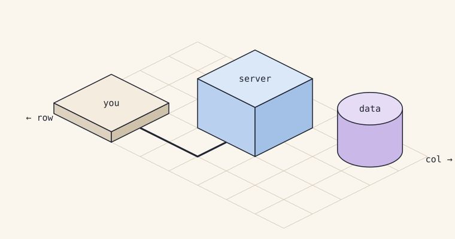

# isometric/ — a floor seen from a corner, as numbers

**Why:** a diagram drawn as blocks on a floor reads at a glance, and a film and a deck should place those blocks the same
way. Nothing recedes in this view: a thing far away is as big as one near, so every label stays readable. Everything here
is numbers in, numbers out. Each tool keeps its own drawing.



| file | holds |
|---|---|
| `grid.js` | the grid: where a point lands, and back; the faces of a box; a round thing's ellipses; the tile lines; a line along the floor |
| `thing.js` | a thing read: where it stands, how big it is; every number checked, a list with a hole refused |
| `order.js` | the order to draw things in so the nearer covers the further (`grid.backToFront`) |
| `arrange.js` | where things stand, worked out from what is joined to what (`arrange`) |
| `fit.js` | the grid on which a picture fills a box of the frame (`gridFor`) |
| `routes.js` | the way each link runs along the floor, round what stands on it, and what there is to say of it (`routes`, `routeNote`) |
| `ports.js` | named points on a thing's side where a link plugs in, and where a route leaves or reaches one (read by `routes`) |
| `path.js` | a way with its corners rounded, and the place a share along it (`rounded`) |
| `words.js` | a name on one line or two, as big as fits a face (`wordsToFit`) |
| `hairpins.js` | where a way doubles back on itself, in a word (`hairpins`) |
| `under.js` | the floor under a box of the frame, as `routes`' keep takes it (`floorUnder`); whether a way on the frame passes through a box (`crossesBox`) |
| `floorLabel.js` | where a floor's name lies, flat along its front edge, clear of what stands there (`floorLabelPlace`) |
| `groups.js` | placing things by group: each group arranged, then the groups (`arrangeByGroup`) |
| `cable.js` | a cable on the frame: its numbers (`CABLE`), a label's plate (`labelHalf`) and its place on the cable (`labelPlace`, `LABEL_PLACES`), a way walked (`walkWay`), points held in their box (`held`), its line stopped short for its head and rounded (`cableWay`; the points alone: `stopShort`) |
| `outline.js` | how far a ray runs before it leaves an outline or a box (`exitOutline`, `exitBox`); a round thing's outline (`roundOutline`) |
| `lead.js` | a cable's lead into a port, drawn again over its block: its way rounded from that end, its pieces through the floor corner and their length (`cableLead`) — the share of the line a tool hands a packet over at |
| `straight.js` | a wire drawn straight between two pieces: its lane (`lanesOf`), its ends (`straightRun`), its bend (`bentWire`), its curve as a way (`curveWay`), its head (`arrowHead`, `headingOf`) |
| `style.js` | a map's look: a row of named choices, one per column, and a piece's paint list in it (`isoStyle`, `paintPiece`) |
| `styleChoices.js` | the choices this package ships: today's look (`box`, `tones`, `ink`, `none`, `theme`) |
| `paint.js` | the paint list: its items, checked as plain data (`PAINT_ITEMS`), and the colour mix (`mixColour`) |
| `mapSpec.js` | a whole map's input checked: the spec (the map as data) and the policy (a tool's numbers: `ISO_MAP_POLICIES`, `ISO_MAP_LIMITS`) |
| `mapSteps.js` | a whole map built as named, pure steps (`ISO_MAP_STEPS`, `buildIsoMap`): place, route, fitFloors, grid, shape, names, order, floorLabels, style |
| `REFERENCES.md` | where the ideas come from, and why not the simpler sort |

```js
import { isometric } from 'footprint-story/isometric';

const grid = isometric({ tile: 120, origin: [960, 240] });   // a tile 120 px wide, 60 tall; the far corner at 960, 240
grid.at(2, 1);                                               // { x: 1020, y: 330 }
const server = { at: [2, 1], size: [2, 2, 1.5] };            // on the tiles from col 2, row 1: 2 wide, 2 deep, 1.5 high
grid.block(server);                                          // { top, left, right, outline, centre, box }
grid.backToFront([{ name: 'front', at: [4, 3], size: [1, 1, 1] }, { name: 'server', ...server }]);   // server first
```

**The words.** `col` runs down and to the right of the frame, `row` down and to the left, height up. A thing stands on
the tiles from `at` (`[col, row]`, or `[col, row, lift]` above the floor) and is `size` tiles: `[wide, deep, high]`.

**A cube looks like a cube.** The grid is the picture a camera with no depth takes from 45° round and, for the usual
two-to-one tile, 30° up. A unit of height (`rise`) follows from that: 0.61 of the tile's width. A test builds that
camera from first principles and compares every point.

**Drawing order.** `grid.backToFront` gives a rule only to two things that meet on the frame: the one drawn first is the
one that can never cover the other (all of it at smaller cols, at smaller rows, or below). Where no rule says otherwise,
directly or through things between them, the order given is kept. Why only those that meet: a rule for every pair orders
things that never touch on the frame, and such rules can run round in a ring the picture does not have (a review found
four boxes where that drew one before a box it covers).

Long boxes can truly be laid each over the next in a ring, and no order is right among them. Such a ring is cut at its
first given thing, and only when nothing outside the ring must be drawn before it: so every rule between a ring and
anything else, another ring too, is still kept (the same review found two rings, one in front of the other, drawn the
wrong way round). A test checks all of this against lines of sight worked out apart from the code, on thousands of
pictures: boxes of any length, flat ones, rings, from four heights.

**Places nobody types.** Whoever writes a picture knows what is joined to what, and should not have to work out where
each block goes. `arrange(things, links)` does that: `things` are `[{name, size}]`, `links` are `[[from, to]]` by name.

```js
const { things, cols, rows } = arrange(
  [{ name: 'you', size: [2, 2, 1] }, { name: 'dns', size: [2, 2, 1] }, { name: 'server', size: [2, 2, 1] }, { name: 'db', size: [2, 2, 1] }],
  [['you', 'dns'], ['you', 'server'], ['server', 'db']],
);   // you [0, 2] · dns [5, 0] · server [5, 4] · db [10, 4]; the arrangement reaches 12 cols and 6 rows
```

A joined thing stands one step further along the cols than what leads to it, so a chain reads from the far corner
towards the viewer's right. Things led to from one place stand side by side along the rows, evenly either side of it
(to the half tile): each thing wants its middle on the middle of what it is joined to, and within a step the things
keep their order and their gaps and stand as near what they want as that allows (least squares: each time a step is
settled, the answer is exact and has one value). The order within a step has few links that cross: the best of a few
tries, not always the fewest there could be. A ring of links is placed too: the link that closes it is read the other
way round. Things joined to nothing stand in rows of their own past the rest, nearer the viewer. A link to a name that
is not a thing here is left out. Every slot is on the half tile (a thing stands in the middle of its slot), `cols` and
`rows` are whole tiles, so `grid.floor({ cols, rows })` lies under the arrangement (a floor is 1 to 256 tiles a side:
nothing arranged reaches 0, and a very long chain reaches past 256), and the same things and links always give the same
places.

**Across the frame.** Along the cols, a chain runs down and to the right of the frame. That is true to the floor, and a
long chain is a long slant that leaves two corners of a wide frame empty. `arrange(things, links, { across: true })`
runs the steps across the frame, left to right, and stands the things of a step one below the other: a step to the
right is a tile along the cols and one back along the rows, a step down is a tile along both. It is the same
arrangement laid out cornerwise, so the same rules hold measured across the frame and down it, where they were
measured along the cols and the rows: a joined thing stands one step to the right of what leads to it on the frame
(along the cols it may stand further back), and the middle of every thing is on the half tile. No step stands in front
of the next that way, so a step needs only room for an arrow: one tile, whatever the heights.

**The gaps.** There are two: `gap` between things side by side in a step, and `step` between one step and the next,
where the links run. Left out, each is what a thing's height asks for. In the usual two-to-one view a thing hides 1.22
tiles of floor behind it for each tile of its height. So `gap` is that for the tallest thing and half a tile of floor
to see, rounded up to the half tile and never under one tile: closer than that, the nearer thing covers the further
one's faces. And `step` is a tile more, never under two, so a link drawn between two steps has floor to be seen on and
room for its arrow. Give either to choose it yourself (another view hides another amount).

A property test holds it to what an arrangement must always be (every thing placed once, none nearer another than the
gaps, a link running on along the cols), the rows are checked against the closed form of the same least-squares answer,
written apart from the code, and a test shows the floor between a thing and a much taller one in front of it.

`gridFor(things, [x0, y0, x1, y1])` then gives the grid on which the placed things fill that box: the usual two-to-one
tile, a whole even number of pixels from 24 to 160 wide (`least`, `most`), the picture in the middle of the box. Every number of this
view grows with the tile, so the picture is measured once and the rest is one division.

**Which views.** Isometric is one of a family of views with no depth (axonometric). This grid gives every one of
them seen from the corner: `tile` is the height the viewer stands at. The usual `120` is two to one, about 30° up (what
tile games call isometric); `[120, 69.3]` (the width over √3) is the true isometric, where all three edges of a cube are
as long as each other; a flatter tile looks from lower, a taller one from higher.

**Links along the floor.** A link drawn straight from thing to thing reads as flying over the floor, and it runs
through whatever stands between. `routes(things, links)` gives each link a way along the tile lines instead:

```js
import { arrange, routes, routeNote, rounded } from 'footprint-story/isometric';

const { things } = arrange([{ name: 'app', size: [2, 2, 1] }, { name: 'logs', size: [2, 2, 1] }, { name: 'db', size: [2, 2, 1] }], [['app', 'logs'], ['app', 'db']]);
const laid = routes(things, [['app', 'db'], ['db', 'app']]);
laid[0];              // { from: 'app', to: 'db', points: [[col, row], …], feet: ['right', 'left'], bends, tiles, behind: [], crosses: 0, shared: 0 }
routeNote(laid[0]);   // null when it lies well — or "app to db: passes behind logs"

const onFrame = laid[0].points.map(([col, row]) => { const p = grid.at(col, row); return [p.x, p.y]; });
const way = rounded(onFrame, 24);    // { start, pieces: [{ to } | { corner, to }], length, at(share) }
way.at(0.5);                         // where a packet riding it stands halfway, by length
```

A route leaves a thing at one of the two feet a viewer sees (`right`: under its right face; `left`: under its left
face), runs along the tile lines, turns square, and comes into the other thing at a foot that is seen: an arrow's tip
at the back of a thing would be covered by it. It never passes under a thing that stands on its floor (a thing
floating above the floor closes nothing: it only hides). It keeps off floor that a thing hides when it can (`hides`:
1.22 tiles for each tile of height, the usual view); where it cannot, `behind` names every thing that hides a point
of it, its two feet and the short runs out of them too. A later link takes the lane beside one laid before it, one
lattice step off (half a tile as a rule), so a request and its answer lie side by side; a foot two tiles wide has
room for three, and past that `shared` says how much of the way lies on another's. `crosses` counts where it meets
a route laid before it, a touch at a corner too. A link alone takes the middle of a foot. Two things at one height above the floor
are joined at that height. A link with no way says `why`: a name that is no thing here, a thing joined to itself, two
different heights, no free place at a foot that can be seen, no way along the floor (walled in), too far apart for the smallest thing, or
too many links (the work is counted, `MOST_WORK`: a picture too big leaves its last links untried, never a build that
hangs).

**Why the result says what happened.** Whoever writes the picture — a person, or a model — can be told "app to db
passes behind logs" in words and move one thing. Without it the picture has to be looked at and the reason guessed.
`routeNote` is that sentence, the same in a deck and in a film.

**How.** The floor is a lattice of points half a tile apart — a quarter or an eighth when the narrowest thing is
under two tiles or one wide, so its foot still has places, and coarser again on a picture so wide that the lattice
would pass 200,000 points (a thing too small for that lattice then has no place, and its links say so). Each link, in the order given, takes the cheapest way
over it: a step costs its length, a turn a tile and a half more (so a way has few bends), hidden floor three times its
length more (so a way goes round where it can be seen), crossing a route laid before two tiles, and running along one
twenty-four (so it takes the lane beside). The same things and links always give the same ways.

**A way with rounded corners.** `rounded(points, radius)` takes a route's points once they are on the frame and
rounds each corner, from `radius` before it to `radius` after it (never over half the shorter run). A piece is a
straight run to `to`, or a corner: one curve to `to`, drawn towards `corner` (SVG's `Q`, a canvas's
`quadraticCurveTo`). `way.at(share)` is the point a share of the way along, by length. It is here and not in each
tool so that a deck's packet and a film's frame stand at the same place on the same way.

**Ports: a link that plugs in where you say.** A thing may name points on its sides, in its own tiles —
`ports: [{ name: 'p1', at: [x, y, z] }]`, x along its width, y along its depth, z up from its base — and a link may end
at one: `[{ thing: 'lap', port: 'rj45' }, { thing: 'sw', port: 'p1' }]` (or a thing's name, as before). The route
leaves the port straight out of its side (a quarter of a tile), drops to the floor, runs out to the lattice and on
along the tile lines, and comes up into the other port the same way, so its line ends on the port itself. `path` is
the whole way in three dimensions, `[col, row, height]` from the first point to the last (a route with no port has
its floor points there, at the floor's height); `points` stay the floor run; `ports` names the port at each end
(null for a foot). Which side a port is on is read from where it is: x = width is `right` (the side toward the lower
right of the frame), y = depth is `left` (toward the lower left), x = 0 `back-left`, y = 0 `back-right`; `face` names
it, and must at a corner, and a wrong one is refused with the right one. A port on a back side is allowed: its plug is on a face turned from the viewer, so `behind` always names its thing,
and `unseen` says how much of the floor run is hidden (none, near a corner, where the floor in front of it is in view). A port whose line out does not fall on a
lattice line meets the first lattice line in front and runs along it to the next lattice point: a turn there, which
merges into the route's own turn when it goes that way. No route crosses a port's run out between two lattice
points (where a crossing could not be counted), and the stretch of the line in front that a port's run joins is that
route's lane, as a foot's run is, so a second link beside it takes the next lane or says it shares. A route that must cross a port's run out laid
before it (a port's run is fixed) counts the crossing, and pays for it. A port within a billionth of a tile of a
lattice line, or of the floor, is taken as on it, so no step of a billionth is drawn.
`points`, `tiles`, `bends` and `unseen` are of the floor run, from the floor point under a port's way out; `path`
adds the stretch out of the port and its riser at each end. Whether a riser is hidden is judged by its floor point. Not yet: a port on the top, or on a round thing (both are
refused, in words). A route whose way out of a port passes under another thing has `why: NO_ROUTE.port`; an end that
names no port of its thing, `NO_ROUTE.portName`. `readPorts(ports, size, round, who)` checks a thing's ports as `routes`
does, so a tool can refuse a wrong one in its own words before it lays anything.

**Fitting the picture to its links too.** A link that runs round a thing reaches past the things, so a picture
fitted to its things alone cuts such a link off. `gridFor(things, box, { also })` takes floor points the picture
holds too: give it the routes' points (`[col, row]`, or `[col, row, lift]`).

**Where a route is hidden.** `unseen` on a route is the stretches of it a thing hides, `[[from, to], …]` in tiles along
the way from its start (empty when nothing hides it): a packet riding it can fade there, and a check can say how long
a stretch is. It is empty exactly when `behind` is. A stretch is right to the nearest half step of the search (a
quarter of a tile on a usual picture, more on a very big one), not to the edge of what hides it; stretches are in
order and never touch.

**Floor kept clear.** `routes(things, links, { keep })` takes floor that words float over —
`keep: [{ at: [col, row, lift?], size: [wide, deep], name? }, …]`, at most 512 — and a route goes round it where it can:
a stretch of the way that passes inside kept floor costs KEPT (4 tiles a tile) more, more than a short way round,
less than closed floor. Where there is no other way the route runs over it, and `under` on the route names every area
its drawn way passes strictly inside (its runs out of its feet and its ports' leads too; along an edge is not inside),
by `name` or by number from 1, in the order given — overlapping areas each named. `under` is there whenever `keep` is
given (`[]` when it crossed none) and absent otherwise. Kept floor is no thing: it never changes the lattice's step
(a picture's other routes lie as they did), it is asked at its own height (`lift`, 0 when left out), and however many
areas there are, or however they overlap, marking them costs the lattice's work, never a link's route. WHY a cost
and not a wall: words over a picture are a reason to go round, never a reason to leave a link with no route.

**A name that fits its face.** `wordsToFit('Load Balancer', [wide, high])` gives `{ lines, size, fits }`: the name on
one line at the usual size (26), else on two lines (broken where they are most alike), else a pixel smaller at a time
down to the least (16). `fits` is false when it does not fit even there: draw it at the least size and say so — a
name too long for its block is the writer's to shorten, and the tool must not hide it. The whole name always comes
back, however long; no words at all gives no lines. It is counted in letters (`letter`: 0.6 of the size, a bold sans
face), because nothing here draws; a tool with a browser can measure after. A mark that sits on a letter and a
character that draws nothing (a zero-width space) take no room. A name breaks at a space, a tab or a line end only: a
no-break space keeps two words on one line. Sizes are from 1 to 1000 pixels. The count suits Latin-like letters: a
script whose letters are wider (Chinese, Japanese, Korean) is under-counted, and wants a bigger `letter` or a measure.

**A name measured by its face.** A tool that can measure (a film's canvas) gives `measure`: each word's width at 1 px
of size, as a function `(word) => width` or a table `{ [word]: width }` (its own stored fields; the space is the word
`' '`). `wordsToFit('Load Balancer', [173, 90], { measure: (w) => ctx.measureText(w).width / 100 })` (with the font at
100 px) sets the name by the same rule — one line, the most even break, a pixel smaller — each line its words' and
spaces' widths summed. It replaces `letter` (giving both is refused); each distinct word is measured once, so the
time still grows with the name's length; a width that is no number from 0 to 1,000,000 is refused, naming the word.
WHY summed, not each line measured whole: the break is chosen among every place a name could break, and summing keeps
that linear. A film's title band breaks by another rule, greedily over any number of lines measured whole
(`footprint-story/layout` · `wrapWords`).

**A name broken by a rule you pick.** `break` chooses where two lines part: `'even'` (the usual, above: the break that
leaves the longer line shortest) or `'fill'` (the first line as full as it goes at each size, the rest beneath it — a
top-heavy name). `wordsToFit('aaaa bb cc dddd', [200, 90])` gives `['aaaa bb', 'cc dddd']`; with `{ break: 'fill' }`
it gives `['aaaa bb cc', 'dddd']`, both at 26. One line is tried first either way, and the sizes the same way. Under
fill a first word too wide for the line has it to itself, and the second line is never empty; fill is never set
bigger than even (even's break is the best a size can have). Fill chooses its break against the width two lines have:
a box too low for two lines still gets fill's break (with `fits: false`), and a face with no width at all for two gets
even's. Left out is the usual; `null` or any other name is refused. The names are `footprint-story/layout`'s `BREAK_RULES`.
Pinned: `test/break-rules.property.test.js` (even against a copy of 0.21.0's `wordsToFit`, fill against an oracle).

**The room on a top face.** The top of a block is a slanted diamond, not the rectangle round it: across its middle it
is as wide as the block's SHORTER side is long (a block 8 by 1 has a top 1 tile wide there, however long it is), and it
narrows above and below. `grid.room(thing, high)` gives the width of an upright box `high` pixels tall that stands on
the top, its middle on the top's centre, inside the top (`thing.round: true` for a round thing). It is a number: what
`block` and `cylinder` give stays plain data. Give it to `wordsToFit` in place of `[wide, high]`:
`wordsToFit('Load Balancer', (high) => grid.room(thing, high))`. Each line is then measured across its own middle (the
room is asked 0 for one line, one line's height for two), so the top of a letter may pass the face's edge where the
line's middle does not, and one line is never refused for the face's height. Scale it to leave a margin:
`(high) => 0.9 * grid.room(thing, high)`. What the function gives is read as a width (no finite number above 0 is no
room; more than a million is a million), and what it throws comes out as it is.

**Where a way doubles back.** A route out of a port that faces away from where it goes leaves the port one way and
runs straight back the other: on the picture, a loop out of nowhere. `hairpins(route.path, route.ports)` says where,
in a word: `'start'` (the first port faces away from the other end, or sideways to it: the port is on the wrong side),
`'start-hook'` (a short loop near a port that faces the right way), the same at the end (`'end'`, `'end-hook'`), or
`'middle'` (a tight U on the floor, under half a tile across). `[]` when it doubles back nowhere. A port end is asked
whether the way runs back within two tiles of it; a foot is not asked (out of a foot a route steps half a tile off the
thing and may step back to change lanes). A riser is upright, so it is no stretch, and a jog under a tenth of a tile
is none either. What to say about it is the tool's: a deck's check words each, with its fix.

**The floor under words.** Words that float over a picture stand in a box of the frame, not on the floor. A route keeps
off the floor they cover (`keep`) only once that floor is known in tiles. `floorUnder({ x, y, w, h }, grid, { lift })`
gives it: `{ stretches, why: null }`, every half-tile square of the floor at `lift` whose drawn diamond meets the box
(exactly), those side by side along a row joined into one stretch, each a hair past its squares so the line between
two is kept too — `routes`' keep as it takes it. A box it has no floor for answers why, and never throws, so a tool
says it in its own words: `NO_UNDER.far` (further than a million px from the frame, or a place that is no finite
number at all — NaN, Infinity — as a page's style can parse to), `NO_UNDER.big` (more than 200,000
squares, counted before any is looked at; `squares` says how many) or `NO_UNDER.most` (more stretches than `most`:
counted as they are made, so many boxes sharing one budget stop at it, not after). The grid is read by its numbers (its
tile, origin and rise), never by its code.

```js
const words = { x: 660, y: 420, w: 180, h: 36 };
const { stretches } = floorUnder(words, grid);
const laid = routes(things, links, { keep: stretches.map((s) => ({ ...s, name: 'lap-name' })) });
// a route that could not keep off: does its way on the frame really run through the words?
crossesBox(laid[0].points.map(([c, r]) => { const p = grid.at(c, r); return [p.x, p.y]; }), words);
```

`crossesBox(points, box)` is whether a way on the frame, straight between its points, passes strictly inside a box: a
stretch along its edge, or one that touches a corner, does not. The router's kept floor is the half-tile squares
round the box, a little wider than the words; whether a route really runs under them is asked of the box itself.

**A floor's name.** `floorLabelPlace({ at, size }, grid, 'Production account', covers, { icon })` lays a floor's name
flat on the floor along its front edge, the way a diagram heads a group box: its lines along the cols, just in from
the edge nearest the viewer on the left, from its far end. It gives `{ x, y }` where the first line's foot starts,
`matrix` (the transform that lays words on the floor: CSS's `matrix(a, b, c, d, 0, 0)`, a canvas's `transform`), the
font `size` (from the tile: 0.3 px a px of a tile's side, 14 to 28), the `lines` (fitted with `wordsToFit`), `fits`
(false when it does not fit along the edge even on two lines at the least size, or two lines are deeper than the
floor) and `covered`. `covers` are the outlines on the frame of what is drawn over the floor — the things, and each
stretch of a laid route as two points: the words move along the edge, half a tile at a time, to the first place whose
strip of floor meets none of them (the separating-axis test), and `covered` says there was none. A label is never cut;
an icon first takes 1.5 of the size more. WHY flat: a plate standing on the floor reads as one more thing. The work is
bounded whatever is handed in: a floor at most 256 tiles a side (at most 512 places), outlines (convex) of at most 64
points (`MOST_OUTLINE_POINTS`) and 1,000,000 in all, each asked by its box before the overlap test, and at most
`MOST_LABEL_LOOKS` (50,000,000) looks — past that it is refused in words, never left to run.

**Groups.** `arrangeByGroup([{ name, size, group }], links)` places things that belong together (an account, a team,
a tier) together: each group is arranged on the links inside it, then the groups — each a thing as big as its things,
`GROUP_MARGIN` (1) tile all round for its floor and half a tile more — on the links between them, both across the
frame. Things with no group (`group` null, or left out) are a group of their own. It gives `[[col, row, 0], …]` in the
order given. A floor fitted round a group's things, a tile past them on every side and out to whole tiles, keeps a
clear tile from the next group's. WHY arrange twice: a group is a thing to the arrangement, so the rule that places
things places groups the same way.

These four came from StoryDeck 0.27.0, unchanged in what they give for what it gave them (property tests against
copies of that code, `test/control/`); every value is now read by its own stored fields and refused in words.

**Not here:** a view turned to another side (the corner is fixed, so no trimetric or plan view), shadows, a round thing
on tiles that are not square, the fewest crossings there could be (links are laid one at a time, in the order given:
an earlier one is never moved for a later one), and a label's place on a way. `grid.route` is the older, simpler line:
it goes where it is told and turns once; `arrange` places nothing by its height. A view that turns is
`footprint-story/shot`'s camera, which has depth today; it is not changed by this. Where the ideas come from:
[REFERENCES.md](REFERENCES.md).

## Styles: a row of named choices, a paint list as data

A map can be drawn flat, outlined, as line art, sketchy, on paper, in pixels. The geometry is the same in all of them;
what changes is a handful of independent choices. So a style is a **row of named choices**, one per column, in the order
they run — each reads only what the one before it gave (the design: `docs/design/2026-11-iso-styles.md`):

| Column | Takes | Gives | This package's choices |
|---|---|---|---|
| `shape` | the piece and the grid | the faces, as items with a role (`top`, `left`, `right`, `side`, `ground`, `grid`) | `box` |
| `shading` | the items, the base colour | a fill per face | `tones`: top 20% toward white, left 6% and right (a cylinder's side) 18% toward black |
| `line` | the items, the ink | strokes | `ink` (2.5 px, round joins; option `width`, 0.5 to 20), `none` (a floor keeps its tile lines) |
| `palette` | the items | the same, recoloured | `theme` |
| `texture` | the items | marks over them | `none` |
| `effects` | the items | items added to the whole, a list of choices | — |

`isoStyle(row, {choices})` checks a row (a column left out is the usual one, USUAL_STYLE: today's look) and gives back
`{row, options}` — plain, frozen data, the record of it. `paintPiece(style, piece, grid, colours)` gives a piece's
`{box, centre, outline, items}` — the box round it, where its name stands, the outline round it — and the **paint list**, plain items in paint order (`polygon`, `ellipse`, `path`, `lines`), each with its
`role`, the piece it is `of`, a `fill` (`{mix, colour}`: the recipe, and the colour it comes to when a base is given)
and a `stroke` (`{colour, alpha, width, join, cap}`). Give no colours and each fill keeps its recipe with no colour, for
a page whose CSS colours each role (StoryDeck's `iso-left`, `iso-right`, `iso-top`, …).

WHY a list and not drawing here: a deck and a film paint the same list, so they draw the same picture; a test compares
lists, not screenshots; and this package stays free of drawing code. Pinned: the usual style's list, painted by a
small canvas painter from a fresh canvas, draws what StoryReel 0.38.0's `drawBlock`/`drawFloor` drew call for call (a
floor's tile lines say join `miter`, where 0.38.0 kept whatever join the canvas had last: separate segments, so nothing
differs on screen), and painted as SVG
writes what StoryDeck 0.32.0's `shapeOf` wrote byte for byte, for any piece on any grid
(`test/isometric-style.property.test.js`, against copies of that code in `test/control/`), with the deck's centre and
outline too. Points are any finite numbers: a far piece on a big grid is far off the frame, never refused.

**A tool's own choice** has the same interface — `{column, name, apply(input, context), options, check, clashes}` — and
a name with the tool's prefix (`'reel:chalk'`; this package's names have none). `apply` takes the items (a `shape`
takes `{piece, grid}` and gives `{box, centre, outline, items}`); `context` holds the piece, the colours, the options written for it,
and `random()`: numbers seeded by the style, the piece's name and the column, so a wobble or a grain is the same every
time it is drawn, in a deck and in a film. `check(options)` refuses a value once, when the style is made. `clashes` names
the choices it cannot sit with and the fix: `isoStyle` refuses that pairing before anything is drawn. What a choice gives
back is checked before the next column reads it — plain data only (no function, no getter, no live object), the items
this package knows, each `of` its own piece, at most MOST_PAINT_ITEMS (512) a piece and MOST_PAINT_POINTS (4096) points an
item, an arc at most half a turn — read entry by entry (never a list's own `map`, a hole or a getter) and copied, so a
later edit of the choice's own objects reaches nothing. A Proxy's traps do run, once, as it is copied. Options are kept
in the order of their names, so `{a, b}` and `{b, a}` are the same style, seeded the same; a clash must name a choice
there is. What it throws comes out as it is: the tool's own code.

```js
const chalk = { column: 'texture', name: 'reel:chalk', options: ['marks'],
  clashes: [{ column: 'line', name: 'none', fix: 'chalk needs an outline to stop at — use line "ink"' }],
  apply: (items, { random, piece }) => [...items, …marks placed with random() …] };
isoStyle({ texture: 'reel:chalk' }, { choices: [chalk] });   // { row: { …, texture: 'reel:chalk' }, options: {} }
```

A copy of a style (`structuredClone`) is its record, not a style: only what `isoStyle` made paints (its choices are held
apart, never on the style), so a record read back can be shown but must be made into a style again to draw.

## A whole map, built as named steps

**Why:** each tool used to build a map in one opaque step of its own compile — place the blocks, lay the wires, fit the
floors, choose the grid, shape the pieces, fit the names, place the floor labels — the same order written twice
(StoryDeck's `deck/iso.js`, StoryReel's `kits/isometric/build.mjs`). Now it is one list of named steps, run in order
(the design: `docs/design/2026-11-map-flow.md`):

```js
import { buildIsoMap, ISO_MAP_POLICIES } from 'footprint-story/isometric';

const map = buildIsoMap({
  blocks: [{ name: 'web', size: [2, 2, 1], label: 'Web', small: 'nginx', who: 'blocks[0] ("web")' },
           { name: 'db', kind: 'cylinder', size: [2, 2, 1.2], label: 'Database' }],
  wires:  [{ from: { block: 'web' }, to: { block: 'db' } }],
  floors: [{ label: 'Production' }],          // no at, no size: fitted round the blocks
  area:   [0, 0, 1600, 900],                  // no grid written: fitted into this box
}, ISO_MAP_POLICIES.film);
map.placed      // 'build'
map.placedWhy   // 'no block has an at: the build places them from their wires, across the frame'
map.at          // [[c, r, lift], …] — block i's place
map.order       // ['web', 'db'] — the furthest first
```

| Step | Reads | Writes | Decides |
|---|---|---|---|
| `place` | blocks, wires | `at`; `placed`, `placedWhy` | the map placed them (every block has an at), or the build from its wires (by group when any has one) |
| `route` | blocks, at, wires | `routes` (null for a straight wire) | — |
| `fitFloors` | blocks, at, floors, routes, policy | `floorTiles` (each floor's at and size) | — |
| `grid` | written, area, … | `view` (tile, origin, rise); `grid`, `gridWhy` | written in numbers, or fitted to the area |
| `shape` | blocks, floors, view, style | `shapes`, `floorShapes` (box, centre, outline, faces: the style's `shape` column) | — |
| `names` | blocks, at, view, policy | `names`, `smalls` (each fitted to its top) | — |
| `order` | blocks, at, view | `order` (block names, the furthest first) | — |
| `floorLabels` | floors, floorTiles, shapes, routes, view | `floorLabels` (each label's place, fits, covered) | — |
| `style` | shapes, style, colours | `paints`, `floorPaints` (the style's other columns) | — |

Each step is `{name, about, reads, writes, run}`: `run(state)` reads only the keys it names and gives back a new state
with the keys it writes. It never edits what it was handed and never puts a function in the state — a block's room is
asked of the grid where it is needed, the grid is kept as its numbers — so every state is plain data a record can keep,
and the built map is the last state, frozen. `buildIsoMap` hands each step only its `reads`, so a step that reads a key
it does not name finds nothing. A step that chooses (`place`, `grid`) also has `decides` (the choice and its reason, as
data) and `branches` (one per choice); `footprint-story/mapflow` runs the same functions as a footprintjs chart, a
decider for each, so a run's record says what each step read, wrote and decided ([src/mapflow/README.md](../mapflow/README.md)).

**The spec** is the map as data, already read by the tool from its own format: `blocks` (`name`, `kind`, `at` or none,
`size`, `label`, `small`, `rule`, `group`, `ports`, `colours`, `who`), `floors` (`name`, `at` and `size` or neither,
`label`, `group`, `colours`, `who`), `wires` (`from`/`to` `{block, port?}`, `straight`, `who`), `grid` (`{tile, origin,
rise?}`) or `area`, `style` (a row of choices) and `who` (the map). `who` is the tool's own words for where a piece was
written: every refusal names it, with the fix, so a tool needs no rewording. Read by own stored fields (a getter is
refused, never run), each list a plain list, bounded (`ISO_MAP_LIMITS`: 256 blocks and floors, 1024 wires), a key a
piece does not take refused. The tools' rules hold: all or none of the blocks have an at, one name one piece, a group's
floor has a block, a wire to a port runs along the floor.

**The policy** is a tool's own numbers, where a deck and a film differ on purpose: `ISO_MAP_POLICIES.film` (StoryReel's
ISO_FIT: a small line fitted down to 12 px; a fitted picture holds every floor that names a group or has a label —
`hold: 'groups-and-labels'`) and `.deck` (StoryDeck's: the small line left as written, `small: null`; only a group's
floor held, `hold: 'groups'`).

Moved from StoryReel 0.38.0's `buildMap` and pinned against a verbatim copy of it (`test/control/storyreel-0.38.0-build.mjs`):
for random maps and the film policy, every block's at, shape, fitted name and small line, every floor's at, size, shape
and label, every route, the grid and the paint order are the same numbers (`test/isometric-map-differential.property.test.js`).
The deck's policy is pinned when StoryDeck builds its maps here. **Not here:** a tool's own style choices (code, which no
record holds: the spec's style is a row of this package's choices), cables on the frame (their line, label, head, lead
and packets — a later step: the tools differ most there), and the deck's footprints, keep-clear and callouts.

